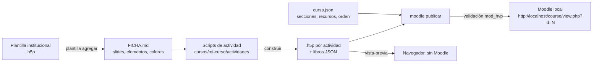

# ph5p

Herramienta para **montar cursos en H5P y Moodle a partir de una plantilla institucional**, sin hacerlo slide por slide en el editor.

Escribes el contenido de cada actividad en un script corto, ph5p clona los slides de tu plantilla H5P (con sus colores, tipografía y distribución), los empaqueta como `.h5p`, los valida con el mismo validador de Moodle y arma el curso completo en un **Moodle local de pruebas**: página de inicio, módulos, foros, tareas, actividades H5P y libros.

> ph5p **no redacta contenido pedagógico**: monta lo que trae la maqueta del profesor. Lo que falta queda marcado como **PENDIENTE**, visible y en naranja. Ver [las especificaciones](docs/06-especificaciones.md).

## Cómo funciona



1. **Plantilla**: registras el `.h5p` institucional; ph5p genera su **ficha**, con cada slide y el número de cada elemento.
2. **Actividad**: un script de Python dice qué slide clonar y qué texto poner en cada elemento.
3. **Curso**: `curso.json` describe las secciones del curso (inicio, módulos) y los recursos de Moodle.
4. **Construir y publicar**: ph5p genera los `.h5p`, traduce la interfaz de H5P al español, los valida y arma el curso en tu Moodle local.

El detalle está en [docs/01-como-funciona.md](docs/01-como-funciona.md).

## Inicio rápido

Requisitos: Windows 10/11, **Python 3.12 o superior**, Git y unos 2 GB libres. Para publicar, un Moodle local (ver [docs/03-moodle-local.md](docs/03-moodle-local.md)).

```bash
cd "C:/ruta/a/ph5p"
```
```bash
python -I ph5p.py construir ejemplo
```
```bash
python -I ph5p.py vista-previa
```

Abre la URL que imprime (`http://127.0.0.1:8765/preview/index.html?h=trabajo/salida/ejemplo/bienvenida`) para ver la actividad de ejemplo sin Moodle.

Con el Moodle local listo:

```bash
python -I ph5p.py moodle configurar "C:/ruta/a/moodle-local/server"
```
```bash
python -I ph5p.py moodle iniciar
```
```bash
python -I ph5p.py moodle publicar ejemplo
```

Al terminar imprime **dónde se abre el curso**, por ejemplo `http://localhost/course/view.php?id=3`. Entras con el usuario administrador que creaste al instalar Moodle.

## Tu propio curso

```bash
python -I ph5p.py curso nuevo mi-curso --plantilla fiuao-6-215
```

Edita `cursos/mi-curso/curso.json` y los scripts de `cursos/mi-curso/actividades/`. Guía completa: [docs/05-crear-un-curso.md](docs/05-crear-un-curso.md).

**Los cursos son privados**: todo lo que pongas en `cursos/` (salvo `cursos/ejemplo`) queda solo en tu equipo y git no lo sube. Ver [cursos/README.md](cursos/README.md).

## Tu propia plantilla

```bash
python -I ph5p.py plantilla agregar "C:/Descargas/mi-plantilla.h5p" mi-plantilla
```

Genera `plantillas/mi-plantilla/FICHA.md` y un `plantilla.json` donde defines los colores institucionales. Guía: [docs/04-plantillas.md](docs/04-plantillas.md).

## Estructura

| Ruta | Qué es | ¿Va en git? |
|---|---|---|
| `ph5p.py` | CLI: la única puerta de entrada | Sí |
| `nucleo/` | Motor en Python: clonado de slides, empaquetado, traducción, ficha, HTML para Moodle | Sí |
| `moodle/` | Scripts PHP que corren **dentro del Moodle local** (curso, H5P, libros, cuestionarios) | Sí |
| `plantillas/<nombre>/` | Plantillas institucionales o generales: `plantilla.h5p`, `plantilla.json`, `FICHA.md` | Sí |
| `cursos/ejemplo/` | Curso mínimo de ejemplo y base de `curso nuevo` | Sí |
| `cursos/<tu-curso>/` | Tus cursos | **No (privado)** |
| `preview/` | Visor H5P sin Moodle (h5p-standalone) | Sí |
| `trabajo/` | Plantillas descomprimidas, `.h5p` generados, logs | No |
| `ph5p.local.json` | Dónde está tu Moodle local | No |
| `docs/` | Documentación | Sí |

## Documentación

1. [Cómo funciona](docs/01-como-funciona.md)
2. [Requisitos](docs/02-requisitos.md)
3. [Moodle local de pruebas](docs/03-moodle-local.md): instalarlo, arrancarlo y dónde se abre el curso
4. [Plantillas](docs/04-plantillas.md): agregar la tuya, ficha y colores
5. [Crear un curso](docs/05-crear-un-curso.md): `curso.json`, scripts de actividad y libros
6. [Especificaciones de montaje](docs/06-especificaciones.md): las reglas que todo curso debe cumplir
7. [Referencia](docs/07-referencia.md): comandos, API de `h5pkit`, bloques de `curso.json`
8. [Problemas conocidos](docs/08-problemas-conocidos.md)

## Importante

- ph5p trabaja contra un **Moodle local**. **Nunca** escribe en el Moodle institucional: el `.h5p` final lo sube a producción quien tenga el rol de edición, desde el formulario de Moodle.
- Las plantillas institucionales pertenecen a su institución. Antes de publicar este repositorio fuera de ella, confirma que puedes compartirlas.
